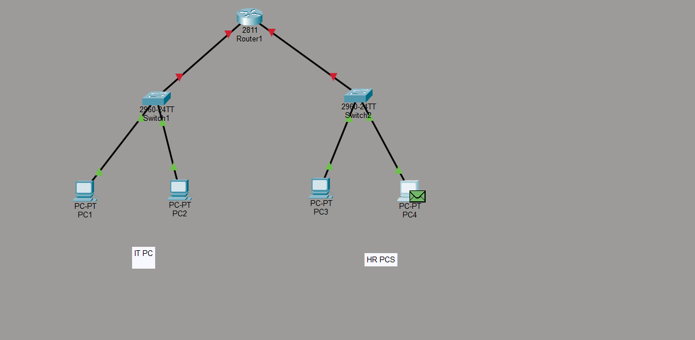

# Small Office Network Lab (Cisco Packet Tracer)

This project demonstrates the design and implementation of a scalable small office network using Cisco Packet Tracer. The primary goal was to implement network segmentation using VLANs to ensure security, reduce broadcast traffic, and organize departmental resources.

## 📌 Project Overview
The network consists of a central router and multiple switches connecting different departments (IT, HR, Finance) and a dedicated server farm. It implements Inter-VLAN routing using both physical interfaces and "Router-on-a-Stick" (sub-interfaces) configurations.

### 🏗️ Network Topology
- **Router:** Cisco 2811 (Core Gateway)
- **Switches:** Cisco 2960 (Access Layer)
- **End Devices:** PCs for IT, HR, and Finance; dedicated Server for the network.
- **Topology Image:** 

---

## 🛠️ Network Design & Addressing

| VLAN | Department | Network Address | Default Gateway | Description |
| :--- | :--- | :--- | :--- | :--- |
| 10 | **IT** | `192.168.10.0/24` | `192.168.10.1` | IT Staff and Administration |
| 20 | **HR** | `192.168.20.0/24` | `192.168.20.1` | Human Resources |
| 30 | **Finance** | `192.168.30.0/24` | `192.168.30.1` | Financial Records |
| 50 | **Servers** | `192.168.50.0/24` | `192.168.50.1` | Centralized Office Servers |

---

## ⌨️ Documentation & Implementation Commands

### 1. VLAN Creation
Used to segment the switch into logical broadcast domains.
```bash
enable
configure terminal
vlan 10
 name IT
vlan 20
 name HR
vlan 30
 name Finance
vlan 50
 name SERVERS
exit
```

### 2. Assigning Access Ports
Configures switch ports to assign end-user devices to their respective VLANs.
```bash
interface fastEthernet 0/1
 switchport mode access
 switchport access vlan 10
 no shutdown
```

### 3. Inter-VLAN Routing (Physical Interfaces)
Configuring the router to act as the gateway for IT and HR using dedicated physical ports.
```bash
interface gigabitEthernet 0/0/0
 ip address 192.168.10.1 255.255.255.0
 no shutdown
exit

interface gigabitEthernet 0/0/1
 ip address 192.168.20.1 255.255.255.0
 no shutdown
```

### 4. Router-on-a-Stick (Sub-interfaces)
Implemented for the Server VLAN (VLAN 50) to allow multiple VLANs to share a single physical router link.
```bash
interface gigabitEthernet 0/0/2
 no shutdown
exit

interface gigabitEthernet 0/0/2.50
 encapsulation dot1Q 50
 ip address 192.168.50.1 255.255.255.0
```

### 5. Switch Trunking
Enabling the link between the switch and router to carry tagged traffic for VLAN 50.
```bash
interface gigabitEthernet 0/1
 switchport mode trunk
 switchport trunk allowed vlan 50
```

### 6. Switch Management (SVI)
Configuring a Virtual Interface so the switch itself can be managed remotely.
```bash
interface vlan 10
 ip address 192.168.10.2 255.255.255.0
 no shutdown
exit
ip default-gateway 192.168.10.1
```

---

## ✅ Verification Commands
Use these commands to verify the health and configuration of the network:

- `show vlan brief` — Verify VLAN assignment and port status.
- `show ip interface brief` — Check IP addresses and interface status.
- `show interfaces trunk` — Ensure trunking is active between switches and routers.
- `ping <ip_address>` — Test connectivity between different VLANs.
- `copy running-config startup-config` — Save all changes to NVRAM.

## 📂 Project Files
- `Small company office network.pkt` — Cisco Packet Tracer Lab File.
- `*.png` — Screenshots documenting each configuration step.
