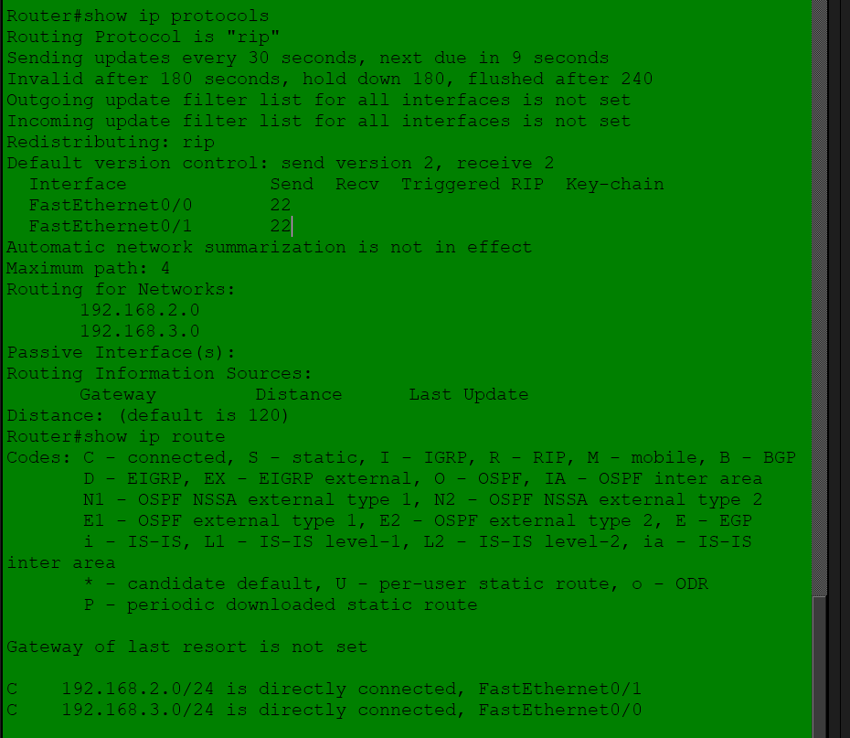
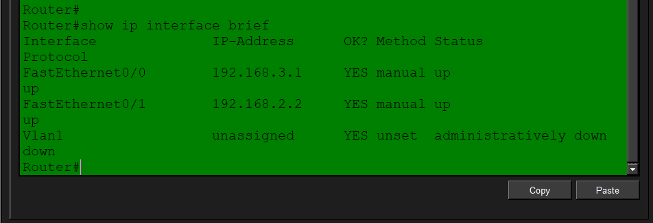
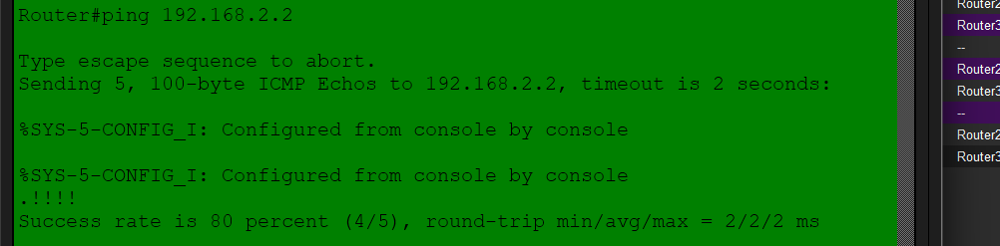
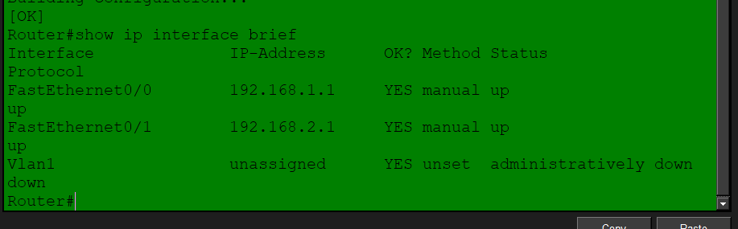
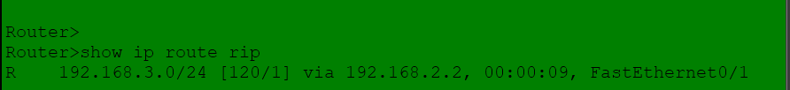
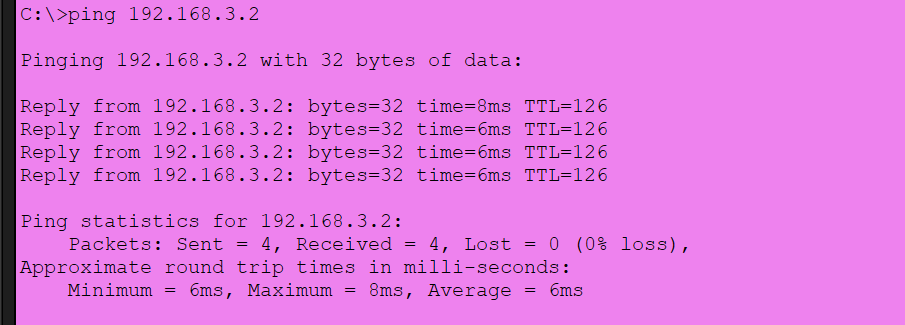

==


RIP Troubleshooting Lab 10
Overview
This lab troubleshoots a routing failure where PC0 could not ping PC2, even though RIP was configured on Router2 and Router3.

The network uses two Cisco 1841 routers and two PCs. The final configuration enables communication between PC0 and PC2 through RIPv2.

Network Topology

PC0 --- Router2 --- Router3 --- PC2


Addressing Table
Device	Interface	IP address	Subnet mask	Default gateway
PC0	FastEthernet	192.168.1.2	255.255.255.0	192.168.1.1
Router2	FastEthernet0/0	192.168.1.1	255.255.255.0	Not applicable
Router2	FastEthernet0/1	192.168.2.1	255.255.255.0	Not applicable
Router3	FastEthernet0/1	192.168.2.2	255.255.255.0	Not applicable
Router3	FastEthernet0/0	192.168.3.1	255.255.255.0	Not applicable
PC2	FastEthernet	192.168.3.2	255.255.255.0	192.168.3.1
Problem
RIP was configured on both routers, but PC0 could not initially ping PC2. The routers had their directly connected networks in their routing tables, but they had not yet learned the remote LAN routes through RIP.

Router2 Configuration


```
enable
configure terminal

interface fastethernet 0/0
ip address 192.168.1.1 255.255.255.0
no shutdown
exit

interface fastethernet 0/1
ip address 192.168.2.1 255.255.255.0
no shutdown
exit

router rip
version 2
no auto-summary
network 192.168.1.0
network 192.168.2.0
exit

end
copy running-config startup-config
```

Router3 Configuration


```
enable
configure terminal

interface fastethernet 0/0
ip address 192.168.3.1 255.255.255.0
no shutdown
exit

interface fastethernet 0/1
ip address 192.168.2.2 255.255.255.0
no shutdown
exit

router rip
version 2
no auto-summary
network 192.168.2.0
network 192.168.3.0
exit

end
copy running-config startup-config
```

Troubleshooting Commands
Check interface status
Run this command on both routers:


show ip interface brief
The relevant interfaces should display up for both Status and Protocol.

Router2 should show:

```
FastEthernet0/0   192.168.1.1   up   up
FastEthernet0/1   192.168.2.1   up   up
```



Router3 should show:

```
FastEthernet0/0   192.168.3.1   up   up
FastEthernet0/1   192.168.2.2   up   up
```


Verify RIP configuration

```
show ip protocols
```

Router2 must advertise:

```
192.168.1.0
192.168.2.0
```

Router3 must advertise:

```
192.168.2.0
192.168.3.0
```

Both routers should use RIPv2 and have automatic summarization disabled.



Verify learned RIP routes
On Router2:

```
show ip route rip
```

Expected result:

```
R 192.168.3.0/24 [120/1] via 192.168.2.2
```

On Router3:

```
show ip route rip
```

Expected result:

```
R 192.168.1.0/24 [120/1] via 192.168.2.1
```



The R indicates that the route was learned using RIP. The metric of 1 indicates that the destination network is one router hop away.

Connectivity Tests
The connection was tested progressively to identify the location of the problem.

Router2 to Router3

```
Router2# ping 192.168.2.2
```

The routers successfully communicated across the 192.168.2.0/24 network.

Router2 to PC2

```
Router2# ping 192.168.3.2
```

The first test produced one timeout followed by four successful replies:

```
.!!!!
Success rate is 80 percent (4/5)
```



This initial timeout can occur while ARP resolves the destination MAC address. A repeated test confirmed connectivity.

PC0 to PC2
From PC0:

```
C:\>ping 192.168.3.2
```

Final result:

```
Packets: Sent = 4, Received = 4, Lost = 0 (0% loss)
Minimum = 6ms, Maximum = 8ms, Average = 6ms
```



This confirms successful end-to-end connectivity between PC0 and PC2.

Root Cause
The original failure was caused by the routers not yet having the required remote RIP routes in their routing tables. After verifying the interface states, confirming the RIPv2 network statements, and allowing RIP updates to propagate, the routers learned the remote LAN routes.

The final routing state was:

Router2 learned 192.168.3.0/24 through Router3 at 192.168.2.2.

Router3 learned 192.168.1.0/24 through Router2 at 192.168.2.1.

PC0 successfully reached PC2 with 0% packet loss.

Conclusion
RIP troubleshooting was completed successfully. All router interfaces were operational, RIPv2 advertised the correct networks, both routers learned their remote routes, and PC0 successfully pinged PC2.

Telnet configuration did not need to be repeated because Telnet is only used for remote CLI access. The connectivity problem was resolved through router interface verification, RIP route verification, and end-to-end testing.

Useful Commands Summary

```
show ip interface brief
show ip protocols
show ip route
show ip route rip
show running-config | section router rip
ping <destination-ip>
copy running-config startup-config
```
